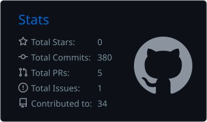
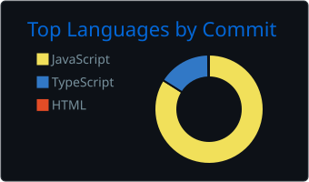
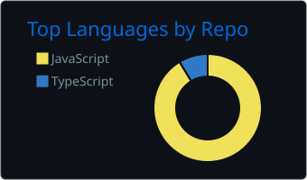
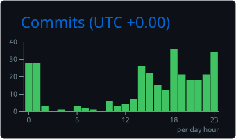

<div align="center">

```
███████╗ █████╗ ███╗   ███╗ █████╗ ██████╗ ████████╗██╗  ██╗        ███╗   ██╗ █████╗  ██████╗ ██████╗  █████╗ ██╗
██╔════╝██╔══██╗████╗ ████║██╔══██╗██╔══██╗╚══██╔══╝██║  ██║        ████╗  ██║██╔══██╗██╔════╝ ██╔══██╗██╔══██╗██║
███████╗███████║██╔████╔██║███████║██████╔╝   ██║   ███████║        ██╔██╗ ██║███████║██║  ███╗██████╔╝███████║██║
╚════██║██╔══██║██║╚██╔╝██║██╔══██║██╔══██╗   ██║   ██╔══██║        ██║╚██╗██║██╔══██║██║   ██║██╔═══╝ ██╔══██║██║
███████║██║  ██║██║ ╚═╝ ██║██║  ██║██║  ██║   ██║   ██║  ██║        ██║ ╚████║██║  ██║╚██████╔╝██║     ██║  ██║███████╗
╚══════╝╚═╝  ╚═╝╚═╝     ╚═╝╚═╝  ╚═╝╚═╝  ╚═╝   ╚═╝   ╚═╝  ╚═╝        ╚═╝  ╚═══╝╚═╝  ╚═╝ ╚═════╝ ╚═╝     ╚═╝  ╚═╝╚══════╝
```

[](https://git.io/typing-svg)

</div>

---

```bash
visitor@github:~$ cat ./about_me.txt

  Name       : Samarth Nagpal
  Handle     : Samarth-254
  Uni        : Maharaja Agrasen Institute of Technology (MAIT), Delhi — B.Tech CSE (AI), Class of 2027
  Focus      : Scalable web apps · backend services · AI-powered systems
  Experience : Founding Technical Intern @ Spendline (Aug–Nov 2026) · SDE Intern @ Datagen (Jul–Oct 2025) · Tech Ops Intern @ DishTV (Jan–May 2025)
  DSA        : 450+ solved on LeetCode · 430+ on TakeUForward
  Status     : ▰▰▰▰▰▰▰▰▰▱  Open to SDE jobs, internships & collabs ✅
```

---

## `> tech.stack`

**Languages**

[](https://skillicons.dev)
[](https://skillicons.dev)
[](https://skillicons.dev)
[](https://skillicons.dev)

**Frameworks & Tools**

[](https://skillicons.dev)
[](https://skillicons.dev)
[](https://skillicons.dev)
[](https://skillicons.dev)
[](https://skillicons.dev)
[](https://skillicons.dev)
[](https://skillicons.dev)
[](https://skillicons.dev)
[](https://skillicons.dev)
[](https://skillicons.dev)
[](https://skillicons.dev)
[](https://skillicons.dev)

---

## `> experience`

**Spendline** — Founding Technical Intern *(Aug–Nov 2026, Remote)*
90+ merged PRs on an AI spend governance platform (Node.js, PostgreSQL) supporting 10 LLM providers. Built provider failover with evidence-based retries (no duplicate billing), month-end close and invoice reconciliation with append-only audit trails, and security hardening (HttpOnly sessions, strict CSP, login lockout, cross-tenant isolation fixes).

**Datagen Internet Services** — Software Development Intern *(Jul–Oct 2025)*
WebSocket-based internal platform, React analytics interface, unified multi-channel ticketing platform, and a Vite-based Agent Platform rebuild.

**DishTV** — Technical Operations Intern *(Jan–May 2025)*
Internal tooling and support framework in PHP and React; reproducible PHPUnit/Postman test cases for API reliability.

---

## `> pinned.projects`

| Project | Description | Stack |
|---------|-------------|-------|
| [**⬡&nbsp;NextFlow**](https://work-flow-builder-kappa.vercel.app/dashboard) | Visual DAG-based LLM workflow orchestrator — Kahn's algorithm for execution order, async parallel execution via Trigger.dev, live run dashboards with scoped real-time tokens *(repo private)* | `Next.js` `TypeScript` `Trigger.dev` `React Flow` `Prisma` `PostgreSQL` |
| [**⬡&nbsp;InterviewAI**](https://github.com/Samarth-254/AI-Interview) | Voice-based AI mock interview platform with a persona interviewer ("Arjun") — real-time voice pipeline, LangGraph state machines, automated PDF feedback reports | `Node.js` `PostgreSQL` `LangGraph` `Vapi` `Deepgram` `Gemini` |
| [**⬡&nbsp;SupportAI**](https://github.com/Samarth-254/Chatbot-frontend) | Hybrid-retrieval RAG chatbot using local semantic embeddings — zero external embedding API cost, full admin console for KB management | `RAG` `Node.js` `MongoDB` `Groq SDK` `Xenova Transformers` |

---

### 💼 Client Work

**[Expadore](https://expadore.com)** — AI travel discovery platform built end-to-end for a live client. Multimodal PDF itinerary ingestion, conversational trip customization, pgvector RAG for semantic package retrieval, async document processing with Trigger.dev, and a persistent Google Places geocoding cache to cut redundant API calls.

**[Wolffoxx](https://wolffoxx.com)** — E-commerce storefront for a streetwear brand. Product catalogue, wishlist, and checkout flows in React/Tailwind, Cloudinary image handling, Razorpay payments, PHP/MySQL backend, deployed on GoDaddy for a live client.

---

## `> github.stats`

<div align="center">







</div>

---

## `> github.streak`

<div align="center">

[](https://git.io/streak-stats)

</div>

---

## `> contribution.snake`

<div align="center">


</div>

---

## `> contact.init()`

```javascript
const contact = {
  email     : "samarthnagpal070@gmail.com",
  linkedin  : "linkedin.com/in/samarth-nagpal",
  portfolio : "portfolio-samarth-nagpal.infinityfreeapp.com",
  leetcode  : "leetcode.com/u/samarthnagpal254",
  tuf       : "takeuforward.org/profile/samarth254",
  status    : "Open to SDE jobs, internships & collabs 🟢",
};

console.log("Building things that ship, not just things that demo.");
```

<div align="center">

[](https://portfolio-samarth-nagpal.infinityfreeapp.com/)
[](https://leetcode.com/u/samarthnagpal254/)
[](https://takeuforward.org/profile/samarth254)


</div>

---

<div align="center">
  <sub><code>// turning ideas into clean, functional software · one commit at a time</code></sub>
</div>
